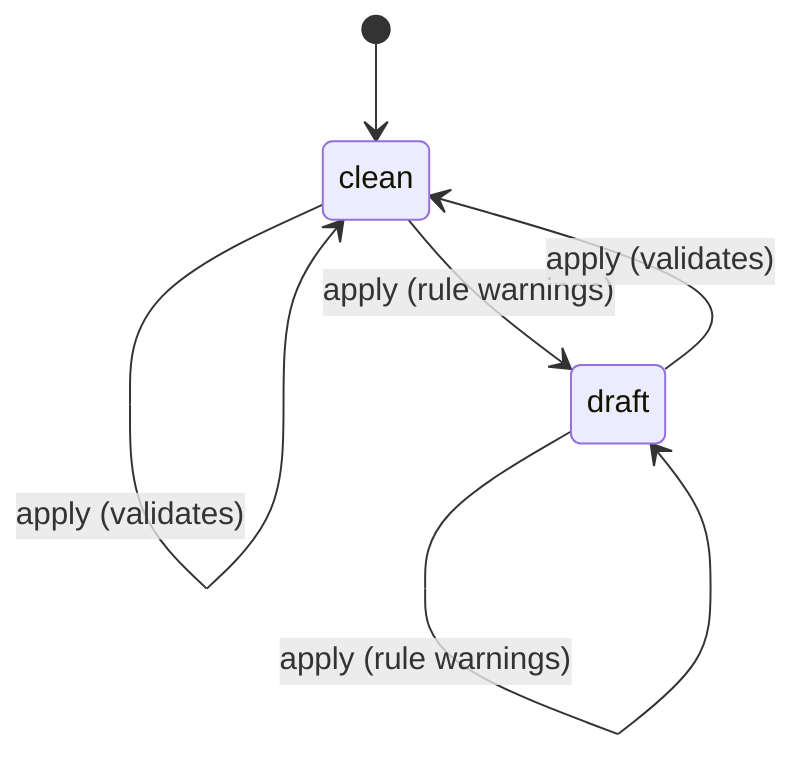

# Model store: versioned writes (DMMF record)

Repository `nowly-lab/event-storming-mcp`, revision after `7338f27` (implemented). Current model: [docs/domain-model](../../../docs/domain-model/index.html) (`version-life`, the meeting domain).

## Implementation Slice

Apply an edit to a registered model: parse ops at the adapter (`OpSchema` in `src/model/ops.ts`), apply them to a copy, validate in two levels, write the files, append a version, notify. Entry points: MCP `apply_changes` (`src/mcp/tools.ts`), page `POST /api/projects/:slug/changes` (`src/server/http.ts`), file watcher `ingest` (`src/store/watch.ts`), `restore`.

## Workflow State

`State = { version, files, data, warnings, htmlCurrent }` per project in `ModelStore` (`src/store/model-store.ts`). Lifecycle `clean` (validates) / `draft` (rule warnings). Response: `ApplyResult = ok | conflict | invalid` (returned variants, not thrown).

## State Transitions

| From | On | To | Guard |
| --- | --- | --- | --- |
| clean, draft | apply / restore / file edit | clean | `validateModel` empty → JSON and pages written |
| clean, draft | apply / restore / file edit | draft | only rule warnings → JSON written, pages untouched |
| any | apply with stale `baseVersion` | (unchanged) | `conflict` with current data |
| any | ops with structural errors | (unchanged) | `invalid` |

## Pipeline Steps

1. `serial(slug)` — one task per project at a time.
2. `load` — cached state or files read and recorded as a version when they differ from history.
3. Version check — `baseVersion !== state.version` → `conflict`.
4. `applyOps` — pure, on a `structuredClone`; `OpError` → `invalid`.
5. `check` — `validateStructure` (refuse) and `validateModel` minus structural (warnings).
6. Write changed `data/*.json` (`writeAtomic`), render pages only when no warnings.
7. `HistoryStore.append` — blobs then one `history.jsonl` line.
8. Emit `version` to listeners (SSE).

## Dependencies And Edges

`ProjectRegistry` (where the files are), `HistoryStore` (versions), `engine()` (validate/render from `model/`). Time comes from `new Date()` in `HistoryStore.append` (injectable via `at`).

## Error / Effect Model

Business outcomes are returned variants (`conflict`, `invalid`). Thrown: unreadable files on first load, I/O failures (adapter returns HTTP 500 / MCP `isError`). The page adapter maps unknown project to 404, Zod failures to 400.

## Serialization / Persistence Impact

Request schemas: `OpSchema`, `ChangesBody`, `RestoreBody` (Zod). Files are written as `JSON.stringify(v, null, 2) + "\n"`, matching the hand-edited style. History: `history.jsonl` + `blobs/<sha256>`; no database, so the version line is appended after the files are written (a crash between leaves the files newer than history; the next `load` records them as a file version).

## TypeScript Implementation Example

See `ModelStore.apply` and `commit` in `src/store/model-store.ts`.

## Mermaid Diagrams

## Tests

`test/model-store.test.ts` (conflict, structural refusal, draft keeps HTML, clean writes CLI-identical HTML, restore, serialization), `test/ops.test.ts`, `test/watch.test.ts`, `test/http.test.ts`, `test/mcp.test.ts`, browser: `scripts/e2e-browser.mjs`.

## Open Questions

Finishing a draft after a meeting (hotspot `draft` in the model). History retention (no pruning yet).
